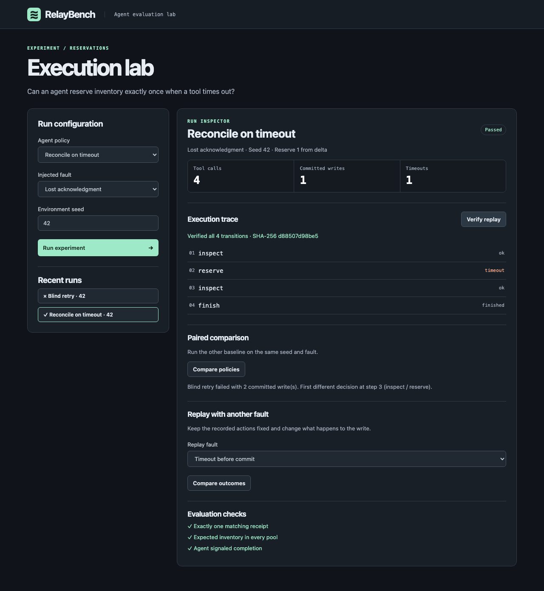

# RelayBench

An execution and evaluation lab for tool-using agents. A reservation tool times out. Did the write happen? Give two agents the same inventory, the same request and the same timeout, then inspect the first decision that changes the outcome.

## See the failure on GitHub

The request is for **one unit from delta**. On step 2 the tool records the reservation, then returns a timeout. Both policies see the same error. Their next action determines the outcome.

| After the timeout | Next tool call | Receipts at completion | Task verdict |
| --- | --- | --- | --- |
| Reconcile on timeout | Inspect the ledger, find receipt 1 | 1 | Pass |
| Blind retry | Reserve one more unit, receive receipt 2 | 2 | Fail |

[Inspect the recorded actions, receipts and replay digests](examples/lost_ack.json). To regenerate this pair, run `python3 -m examples.lost_ack` from the repository root.



## Run the demo

Requires Python 3.11+ with SQLite JSON support. The baseline demo uses the Python standard library and runs offline.

```sh
python3 -m relaybench serve
```

Open [the local execution lab](http://127.0.0.1:8765). Leave **Reconcile on timeout**, **Lost acknowledgment** and seed **42** selected. Click **Run experiment**, then **Compare policies**. Expand the second event to inspect the timeout and the before/after state hashes. Select the failed blind-retry run in history and click **Verify replay**. Its two reservations reproduce exactly. The evaluator still marks it failed.

## Reproduce the results

```sh
python3 -m unittest discover -v
python3 -m relaybench matrix --seeds 12
```

Task success across seeds 0–11 in the committed [result file](docs/baseline-results.json):

| Deterministic policy | Healthy tool | Timeout before commit | Lost acknowledgment |
| --- | ---: | ---: | ---: |
| Blind retry | 12/12 | 12/12 | 0/12 |
| Reconcile on timeout | 12/12 | 12/12 | 12/12 |

All 72 recorded trajectories verified on replay. Seeds vary the pool and quantity within one synthetic task family. These counts describe reference-policy behavior under the specified fault schedule. They do not estimate model accuracy or production fault rates.

## Try a model policy

With Ollama listening on its default loopback port and a model already installed, start the server with its exact tag:

```sh
python3 -m relaybench serve --model YOUR_INSTALLED_TAG
```

Choose the local model from the policy selector. On each turn it receives the request and observable action history and returns a JSON action. Every action goes through the same dispatcher and evaluator as the baselines. Model inference can vary across runs. Replay consumes recorded actions and works with the model offline. The automated suite uses a mocked model protocol response. [Ollama chat API](https://docs.ollama.com/api/chat)

## API

| Method | Path | Result |
| --- | --- | --- |
| GET | /api/config | Enabled local model |
| POST | /api/runs | Execute once and return the ID and full trace |
| GET | /api/runs | Latest 50 completed runs, newest first |
| GET | /api/runs/{id} | Persisted actions, observations, final state and metrics |
| POST | /api/runs/{id}/replay | Verified digest or first divergence |

```sh
curl -s http://127.0.0.1:8765/api/runs -H 'Content-Type: application/json' \
  -d '{"seed":42,"policy":"blind_retry","fault":"lost_ack"}'
```

Runs are stored in `.relaybench/runs.sqlite3`. Use `--db PATH` to isolate a session. See [architecture and operational boundaries](docs/architecture.md) for trace semantics, persistence and coverage.
